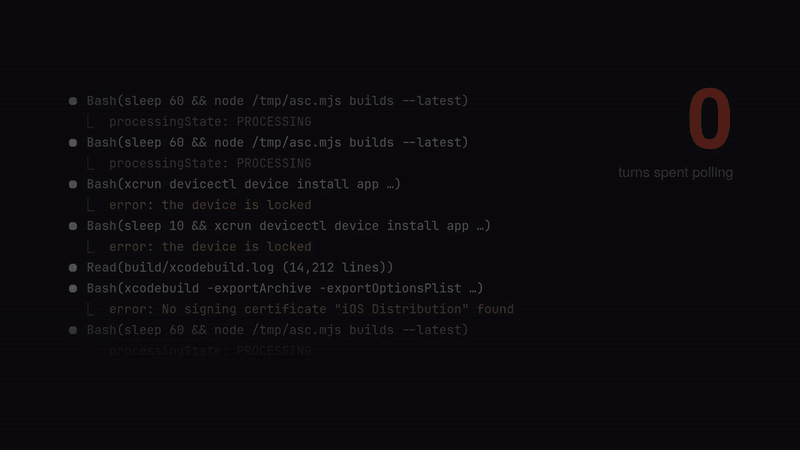

# eve

**iOS builds for coding agents.** Your agent runs one command, and your own Mac builds, signs
and delivers the app to TestFlight, your iPhone or the Simulator. The command returns when it's
done, with a short result the agent can act on.

[](docs/media/eve.mp4)

## Why

An agent that ships an iOS app by hand spends its turns babysitting. It polls App Store Connect
with `sleep 60`, rebuilds after each signing error, rereads thousands of lines of xcodebuild log
and works out the toolchain again every session. Each of those turns rereads the whole
conversation, so they add up.

eve replaces all of it with one long command, and an agent waiting on a command spends no tokens.

```console
$ eve submit testflight --wait --events
eve j_mvbcdz6285e96fe933 archiving: archiving build 202610161909
eve j_mvbcdz6285e96fe933 delivering: signing and uploading build 202610161909
eve j_mvbcdz6285e96fe933 processing: uploaded; waiting for App Store Connect to process it
eve j_mvbcdz6285e96fe933 result SUCCEEDED {"id":"j_mvbcdz6285e96fe933",…}
```

- **The exit code is the outcome,** and the result is under 4 KB.
- **Failures come with the fix:** a classified cause, a hint and a short excerpt, never the raw
  log.

  ```json
  "failure": {
    "class": "upload.purpose_string",
    "summary": "Apple rejected the upload: Info.plist lacks NSCameraUsageDescription.",
    "hint": "Add NSCameraUsageDescription with a user-facing purpose string to Info.plist …"
  }
  ```

- **It knows when only a person can help.** A locked phone or a signed-out Xcode ends the job
  with exit 78 and one line for the agent to pass on, instead of a retry loop.
- **You can walk away.** Jobs survive network drops, server restarts and the agent's session
  ending, and `eve pending` finds outcomes nobody collected.

## What it builds

| Verb | What happens |
|---|---|
| `testflight` | Archive, sign, upload, follow processing, add to your internal group, set What to Test |
| `device` | Install and launch on your iPhone over Wi-Fi or USB, waiting up to ten minutes for it to come back |
| `check` | Build for the Simulator and optionally run the tests; a failing test is named with its assertion |
| `exec` | Run a script from your repo on the Mac, such as screenshot generation, and download what it wrote |

It builds Xcode projects, XcodeGen specs and workspaces. Expo (React Native) apps build from the
workspace `expo prebuild` generates, without EAS ([adding an app](docs/new-app.md#expo-react-native-apps)).

## Set up

You need an always-on Mac with Xcode, signed in to your Apple ID in Xcode and logged in at the
console. You also need an Apple Developer team, an App Store Connect API key (App Manager is
enough), and a private network such as Tailscale between your machines. Clients can run macOS,
Linux or Windows.

```sh
brew install --cask self-deprecated/tap/eve                 # macOS
scoop bucket add self-deprecated https://github.com/self-deprecated/scoop-bucket
scoop install self-deprecated/eve                           # Windows
```

Linux archives are on the [releases page](https://github.com/self-deprecated/eve/releases). With
Nix, the flake's `homeManagerModules.default` runs the server.

**On the Mac,** write `~/.config/eve/server.yml` with your team, API key and apps
([configuration](docs/configuration.md)). Then:

```sh
eve agent install --config ~/.config/eve/server.yml   # runs the server in your GUI session
eve doctor --host                                     # checks signing, Xcode and App Store Connect
eve token create laptop                               # one token per client machine
```

**On each client:**

```sh
eve login https://eve.<tailnet>.ts.net --token eve_…
cd ~/src/myapp && eve init                            # writes eve.yml from your project
eve submit check --wait                               # a Simulator build proves the setup
```

**Give your agent the skill.** [skill/eve/SKILL.md](skill/eve/SKILL.md) tells it to submit and
wait in one command, read only the result, and pass on what a person has to do. Copy it to
`~/.claude/skills/eve/` for Claude Code or to wherever your agent reads skills. Release archives
include it, and the Nix module installs it. After that, "ship it to TestFlight" is enough.

[docs/setup.md](docs/setup.md) covers publishing on your tailnet, reboots and disk use, and
[docs/new-app.md](docs/new-app.md) covers adding apps.

## Trust model

- **A token that can submit a build can run code as you on the Mac.** Build phases and scripts
  run as the logged-in user with the keychain unlocked. Issue one token per machine you control,
  and revoke them with `eve token revoke`.
- eve listens only on loopback; publish it on your tailnet, never the internet. Stored and served
  logs are redacted.
- It uses one Mac and runs one job at a time. It doesn't do App Store submission, external
  TestFlight groups or Android.

## More

- [Commands and exit codes](docs/commands.md)
- [Troubleshooting](docs/troubleshooting.md)
- [Simulator lifecycle and borrowing](docs/operations.md)
- [Design](docs/design.md): the decisions and review history

Development: `nix develop`, then `go test -race ./...`. Pushing a `v*` tag that matches
`nix/package.nix` releases to GitHub, Homebrew and Scoop.

eve is the name of the one who takes the apple. MIT licensed.
